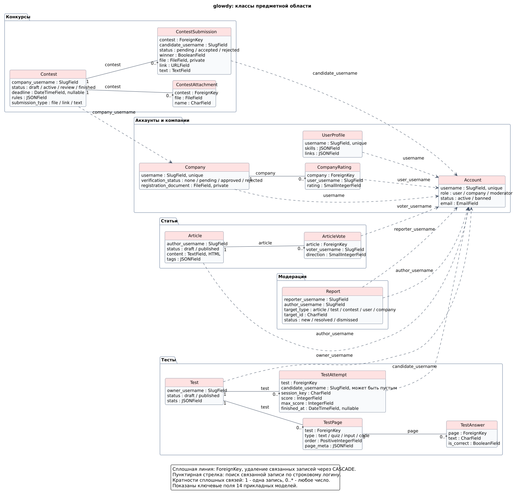
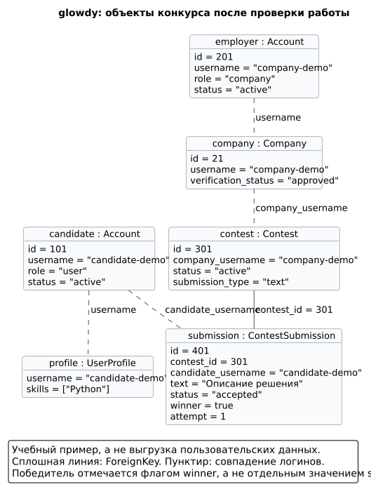
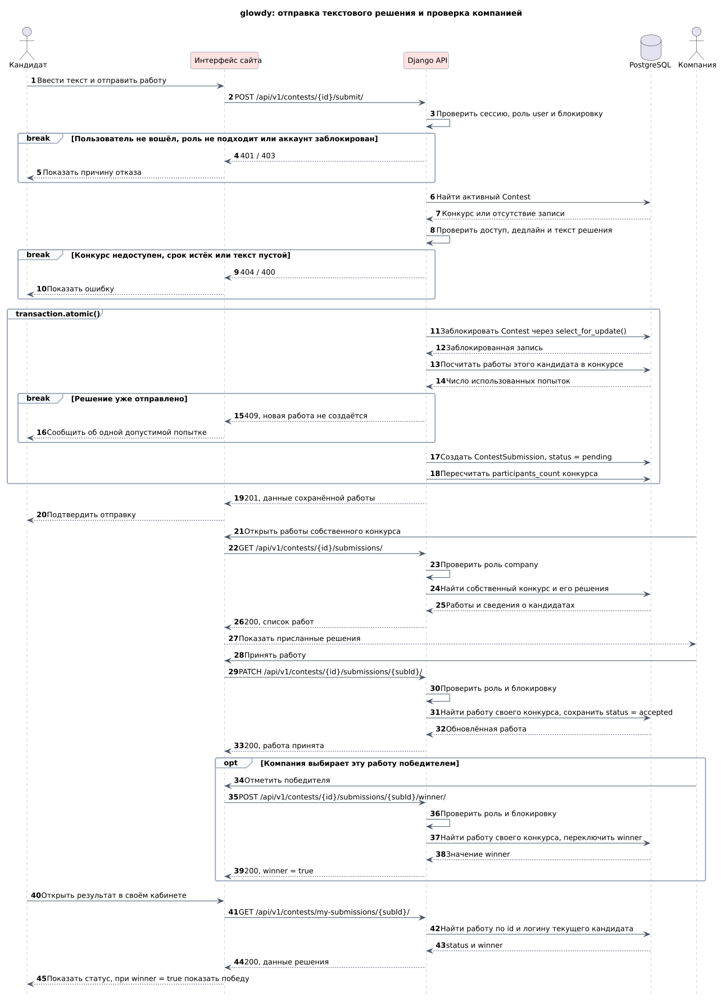

# Диаграммы проекта

## UML-диаграмма классов

[](docs/diagrams/model-classes.svg)

[PNG](docs/diagrams/model-classes.png) · [Исходник PlantUML](docs/diagrams/model-classes.puml)

Сплошные связи соответствуют настоящим `ForeignKey` с `on_delete=CASCADE`. Пунктирные стрелки показывают сопоставление строковых логинов: например, `Contest.company_username` и `Company.username`. Кратности указаны только для связей через `ForeignKey`.

У `TestAttempt.candidate_username` допускается пустое значение: анонимные прохождения различаются по сессии. Жалоба `Report` указывает на материал или профиль через пару `target_type` и `target_id`, а не через внешний ключ. Для голосов действует уникальность пары «статья + пользователь», для оценок - «компания + пользователь», для жалоб - «заявитель + тип цели + идентификатор цели».

Модели: [аккаунты](NIS/authorization/models.py), [профили](NIS/users/models.py), [компании](NIS/companies/models.py), [статьи](NIS/articles/constructor/models.py), [тесты](NIS/tests/constructor/models.py), [конкурсы](NIS/contests/contests_cabinet/models.py), [жалобы](NIS/administration/reports/models.py).

## Объектная диаграмма

Учебный снимок состояния: кандидат отправил текстовое решение на конкурс подтверждённой компании, компания приняла работу и отметила её победителем.

[](docs/diagrams/contest-objects.svg)

[PNG](docs/diagrams/contest-objects.png) · [Исходник PlantUML](docs/diagrams/contest-objects.puml)

У каждого прямоугольника указаны имя объекта, класс и значения выбранных полей. Аккаунты кандидата и компании показаны отдельно от их профилей. `winner` - самостоятельный флаг: значение `winner` не входит в список статусов решения.

## UML-диаграмма последовательности

Показан сценарий подачи текстовой работы, её проверки владельцем конкурса и просмотра результата кандидатом. Изменяющие запросы предполагают корректный CSRF-токен. На схеме отражены ключевые запросы, без всех вспомогательных запросов.

[](docs/diagrams/contest-sequence.svg)

[PNG](docs/diagrams/contest-sequence.png) · [Исходник PlantUML](docs/diagrams/contest-sequence.puml)

Проверка компании выполняется до публикации конкурса. При отправке работы сервер проверяет доступ, активность конкурса, срок и содержимое. Лимит одной попытки проверяется в транзакции с блокировкой конкурса. Компания меняет статус и флаг победителя отдельными запросами, а кандидат узнаёт результат при открытии кабинета.

Реализация: [маршруты API](NIS/api/v1/urls.py), [обработчики конкурсов](NIS/contests/contests_cabinet/api_views.py), [проверки ролей и блокировок](NIS/core/auth.py), [доступ к конкурсам](NIS/contests/access.py).

## Обновление изображений

Исходники находятся рядом с изображениями в `docs/diagrams/`.

Из корня репозитория, указав путь к своему `plantuml.jar`:

```bash
java -Djava.awt.headless=true -jar /path/to/plantuml.jar -checkonly docs/diagrams/*.puml
java -Djava.awt.headless=true -jar /path/to/plantuml.jar -tsvg docs/diagrams/*.puml
java -Djava.awt.headless=true -jar /path/to/plantuml.jar -tpng docs/diagrams/*.puml
```
