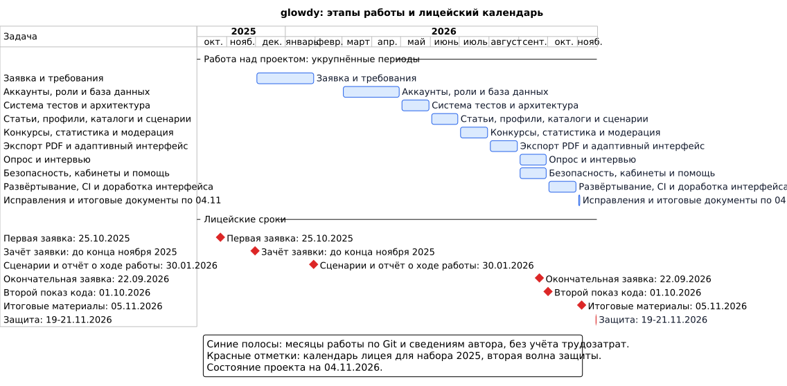

### Группа: 11 - И - 4

### Электронная почта: [egomalt@mail.ru](mailto:egomalt@mail.ru)

### Tg: egomalt

**[ НАЗВАНИЕ ПРОЕКТА ]**

“[Alfa-ИВР] Кейс №12 - HR-решение для проведения ИТ-собеседований”

**[ ПРОБЛЕМНОЕ ПОЛЕ ]**

Начинающие ИТ-специалисты готовятся к тестовым заданиям и собеседованиям, а компании проводят отбор кандидатов на стажировки и начальные позиции. Для подготовки используются материалы о собеседованиях, тренировочные задания и практические кейсы.

Для соискателей:
Материалы для подготовки, задания и информация о компаниях находятся на разных сайтах. Из-за этого приходится держать открытыми несколько ресурсов и отдельно следить за заданиями, сроками и результатами.
Затруднён поиск структурированной информации о реальном опыте прохождения собеседований в различных компаниях.
Сложность в целевой подготовке к тестовым заданиям конкретных работодателей из-за дефицита практических материалов, соответствующих актуальным требованиям.
Затруднён поиск отзывов и аналитики о компаниях от реальных сотрудников и кандидатов, что мешает формированию полной картины работодателя.

Для компаний (работодателей):
Необходимость отдельно организовывать публикацию заданий, сбор решений и просмотр результатов при отборе кандидатов на стажировки или вакансии.
Затруднено получение общей аналитики и статистики по результатам испытаний, если задания и решения находятся в разных инструментах.
Сложность выделения перспективных кандидатов без опыта по резюме, в котором не отражены результаты выполненных заданий и участия в конкурсах.

**[ ЗАКАЗЧИК / ПОТЕНЦИАЛЬНАЯ АУДИТОРИЯ ]**

Целевая аудитория:
1. Молодые специалисты, которые ищут начальный опыт и информацию о том, как его получить для того, чтобы иметь приоритет при поиске работы
2. Компании, ищущие перспективных молодых специалистов

**[ АППАРАТНЫЕ / ПРОГРАММНЫЕ ТРЕБОВАНИЯ ]**

Продукт разрабатывается в виде веб-сервиса и к моменту сдачи должен работать на следующих конфигурациях:

Для пользователя:
- Браузер с поддержкой JavaScript на компьютере или телефоне
- Подключение к интернету

Основные требования для браузеров:
- Chrome / Edge, включая Chrome на Android	108+
- Firefox	121+
- Safari на Mac	16.4+
- Safari на iPhone / iPad	iOS / iPadOS 16.4+

Для сервера для хостинга:
- ОС: Linux (Ubuntu), архитектура x86_64
- CPU: 2 ядра
- RAM: 4 GB
- Storage: 50 GB NVMe
- Git для получения исходного кода
- Docker Engine с работающим демоном и доступом к нему у пользователя, запускающего приложение
- Docker Compose v2 или новее
- Образы `python:3.11-alpine`, `node:20-alpine` и `gcc:12` для проверки задач на код
- Домен, привязанный к IP сервера, и открытые порты 80 и 443, свободные для Caddy
- Файл `.env` с настройками домена, секретным ключом приложения и параметрами базы данных

Зависимости приложения, PostgreSQL, Gunicorn и Caddy разворачиваются в контейнерах Docker. Порядок сборки и запуска описан в [README.md](README.md).

**[ ФУНКЦИОНАЛЬНЫЕ ТРЕБОВАНИЯ ]**

Программный продукт будет предоставлять следующие возможности:

- Фильтрация статей по выбранным пользователем параметрам
- Публикация статьи/отзыва
- Регистрация/Аутентификация.
- Прохождение тренировочных тестовых заданий
- Публикация тренировочных тестовых заданий от пользователей или компаний
- Создание конкурса компанией
- Вывод статистики компании
- Вывод статистики пользователя
- Отслеживание серии активности пользователя на сайте
- Админ панель для модерации сайта

**[ ПОХОЖИЕ / АНАЛОГИЧНЫЕ ПРОДУКТЫ ]**

- LeetCode: тренировочные задачи, материалы для подготовки к собеседованиям, соревнования и обсуждения опыта отбора. Основной акцент - практика программирования и подготовка к техническим интервью
- Хабр Карьера: вакансии, профессиональные профили, материалы и оценки работодателей. Основной акцент - поиск работы и подбор ИТ-специалистов
- hh.ru: вакансии, резюме, поиск работы и отклики работодателям. Основной способ представления опыта и навыков кандидата - резюме
- Сайты компаний: информация о программах и этапах отбора размещается на ресурсах отдельных работодателей, поэтому при поиске нескольких стажировок кандидат отслеживает разные источники

**[ ИНСТРУМЕНТЫ РАЗРАБОТКИ, ИНФОРМАЦИЯ О БД ]**

- Python, Django (Backend)
- JavaScript без фреймворков (Frontend)
- PostgreSQL (БД)
- Docker (изолированная проверка кода и развёртывание)
- Gunicorn, Caddy (сервер, HTTPS)
- ReportLab (экспорт статистики в PDF)
- nh3, DOMPurify (очистка HTML от XSS)
- GitHub Actions (CI/CD: тесты, стиль кода, деплой)
- ruff, ESLint (стиль кода)

**[ ЭТАПЫ РАЗРАБОТКИ ]**

- Декабрь 2025 - январь 2026: подготовка заявки и уточнение требований
- Март - апрель 2026: регистрация, профиль компании, роли и база данных
- Май 2026: система тестов и уточнение архитектуры
- Июнь 2026: задачи на код, статьи, каталоги, профили и первая версия сценариев
- Июль 2026: конкурсы, статистика, административная панель и модерация
- Август 2026: экспорт PDF, кабинеты и адаптивный интерфейс
- Сентябрь 2026: опрос и интервью, исправление доступа и редакторов, кабинеты, статистика, помощь и уточнение сценариев
- Октябрь 2026: производственное развёртывание, CI/CD, фильтры каталогов и доработка интерфейса
- 1-4 ноября 2026: исправления, оформление результатов исследования, итоговых материалов и диаграмм

[PNG](docs/diagrams/project-gantt.png) · [Исходник PlantUML](docs/diagrams/project-gantt.puml)

**[ ВОЗМОЖНЫЕ РИСКИ ]**

Создание неудобного пользовательского интерфейса
Пути преодоления:
Использовать единую дизайн-систему как основу для интерфейса: общие цвета, отступы и компоненты для всех страниц, светлая и тёмная тема.
Провести пользовательское тестирование ключевых сценариев и исправить обнаруженные неудобства.
Собирать фидбэк от первых пользователей во время тестирования и через опросы.

Неправильная оценка технологического стека и нехватка времени на изучение
Пути преодоления:
Провести детальный анализ технологий на этапе планирования, проконсультировавшись с опытными разработчиками.
Выбрать технологии с большим сообществом и хорошей документацией (Django для бэкенда, JavaScript без фреймворков для фронтенда, PostgreSQL для базы данных).

Сложность реализации качественной системы редактирования статей
Пути преодоления:
Использовать встроенные возможности браузера для редактирования текста вместо разработки редактора с нуля, а HTML статьи очищать на сервере от опасных тегов.
Реализовать MVP с базовым функционалом форматирования текста, с последующим постепенным добавлением возможностей.
Провести пользовательское тестирование на ранних этапах для определения действительно необходимого функционала.

Нагрузка на сервер при проверке пользовательского кода
Пути преодоления:
Ограничивать время выполнения, память и число процессов в контейнере.
Проверить работу системы при нескольких одновременных запусках.
